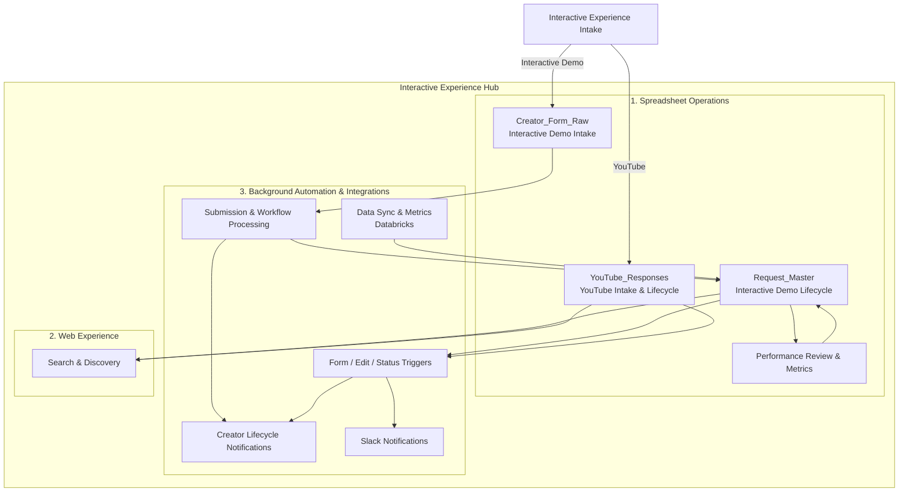
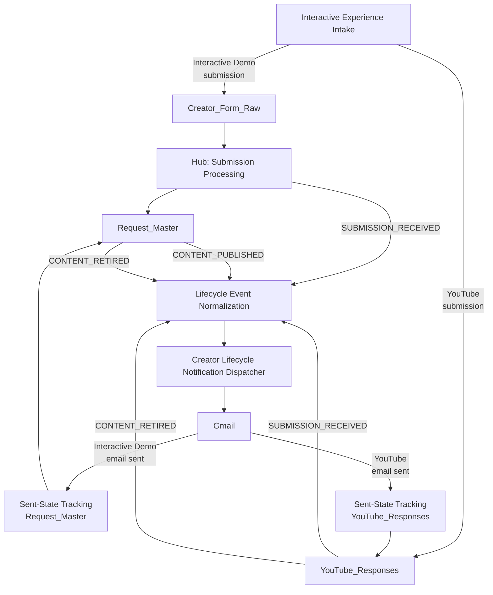
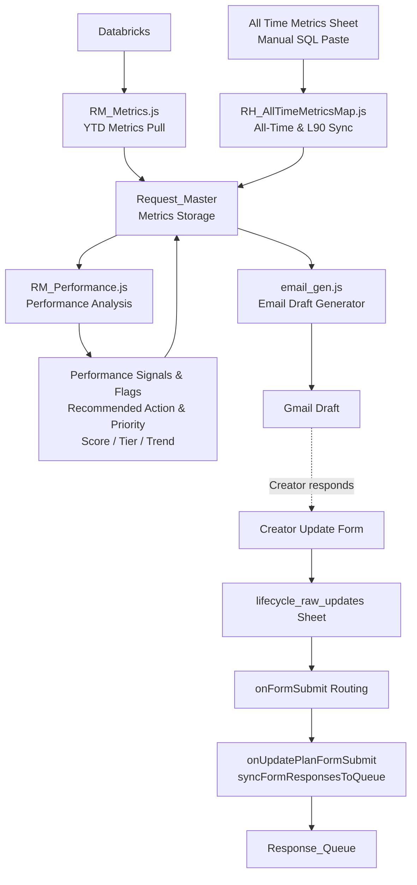

# Interactive Experience Architecture

## System overview

The Interactive Experience program supports two primary applications:

**Interactive Experience Intake**
- Creator-facing submission experience for Interactive Demo and YouTube content
- AI-assisted metadata drafting
- Review and status tracking interface (Status Tracker)
- Writes Interactive Demo submissions to Creator_Form_Raw
- Writes YouTube submissions to YouTube_Responses
- Notifies Hub for downstream processing

**Interactive Experience Hub**

The Hub is a Google Apps Script solution with three main areas:

1. **Spreadsheet Operations** — Content lifecycle management and performance review workflows
2. **Web Experience** — Search and discovery for Interactive Experience content
3. **Background Automation & Integrations** — Notifications, triggers, and data synchronization

The spreadsheet is the Hub's operational workspace and data layer. The Apps Script project is the execution layer.

## Hub structure



## Data flow

**Interactive Demo:**
```text
Interactive Experience Intake
        ↓
Creator_Form_Raw
        ↓
Interactive Experience Hub
        ↓
Request_Master
        ↓
Hub capabilities:
Lifecycle workflows / Creator notifications / Search & Discovery
```

**YouTube:**
```text
Interactive Experience Intake
        ↓
YouTube_Responses
        ↓
Interactive Experience Hub
        ↓
Hub capabilities:
Lifecycle workflows / Creator notifications / Search & Discovery
```

## Creator Lifecycle Notification Flow

The Hub centralizes creator lifecycle email notifications for both Interactive Demo and YouTube content.



**Key principles:**
- Hub normalizes content-type-specific statuses into shared lifecycle events
- Interactive Demo produces three lifecycle events (submission, published, retired)
- YouTube produces two lifecycle events (submission, retired) — no separate published email
- Email sent-state tracking is independent from Slack notifications
- Intake does not send creator lifecycle emails independently

## Performance Review Workflow

The Hub supports periodic performance review by combining metrics data, generating recommendations, and facilitating creator update-plan responses.



**Key components:**
- **RM_Metrics.js** — Pulls YTD engagement and sales metrics from Databricks API
- **RH_AllTimeMetricsMap.js** — Syncs all-time and L90 metrics from manual SQL paste
- **RM_Performance.js** — Analyzes metrics and generates performance signals, flags, and recommendations
- **email_gen.js** — Generates Gmail drafts for creator performance review (manual, not automatic lifecycle emails)
- **Performance review responses** — Routed through central onFormSubmit to Response_Queue for admin follow-up

**Important distinctions:**
- Performance review emails are **Gmail drafts** generated manually, not automatic lifecycle notifications
- YTD metrics (Databricks API) and all-time/L90 metrics (manual SQL) are separate workflows
- Creator update-plan responses flow through lifecycle_raw_updates → Response_Queue for admin review

## Content types

**Interactive Experience** is the overall program.

Currently supported content types:
- **Interactive Demo**
- **YouTube** (video content)

Each content type may maintain its own status model and workflow within its source repository.

## Repositories and identity

The Hub processes content from multiple repositories:

- **Creator_Form_Raw** — Initial Interactive Demo creator submissions from Intake
- **Request_Master** — Downstream Interactive Demo lifecycle and workflow records
- **YouTube_Responses** — YouTube intake and lifecycle records

Downstream lifecycle records are resolved using:

```text
sourceRepository + Number
```

where `sourceRepository` is the downstream lifecycle repository (Request_Master or YouTube_Responses) and `Number` refers to the value in that repository's `Number` column, not the physical spreadsheet row number.

## Lifecycle normalization

For creator lifecycle notifications, the Hub normalizes content-type-specific statuses into shared lifecycle events:

- **SUBMISSION_RECEIVED** — Initial creator submission
- **CONTENT_PUBLISHED** — Content has reached the published lifecycle stage
- **CONTENT_RETIRED** — Content is no longer active

Raw statuses can differ by content type, but lifecycle notifications use these normalized events.

**Example**: A newly submitted YouTube record may have raw `Status = Published` in YouTube_Responses, but still maps to `SUBMISSION_RECEIVED` for creator lifecycle notification purposes. This is because YouTube videos are already published to YouTube before entering the Interactive Experience workflow.

## Notification architecture

The Hub is the centralized lifecycle notification layer.

**Key principles**:
- Slack notifications and creator email notifications are independent channels
- Each channel maintains its own sent-state tracking
- One notification channel failing should not block the other
- Idempotency is enforced via per-event sent-state columns

**Sent-state columns** (example):
- `Creator Submission Email Sent?`
- `Creator Published Email Sent?`
- `Creator Retired Email Sent?`

These are independent from Slack notification sent flags.

## Design principles

- **Content types may keep their own status models** — YouTube records use "Published" as their initial status, while Interactive Demos use "Demo Received"
- **Shared lifecycle behavior is normalized in the Hub** — Downstream workflows operate on normalized lifecycle events, not raw statuses
- **Intake owns submission experience** — Creator-facing forms, AI-assisted drafting, and Status Tracker live in the Intake application
- **Hub owns downstream lifecycle orchestration** — Notifications, Discovery, performance analysis, and data synchronization are Hub responsibilities
